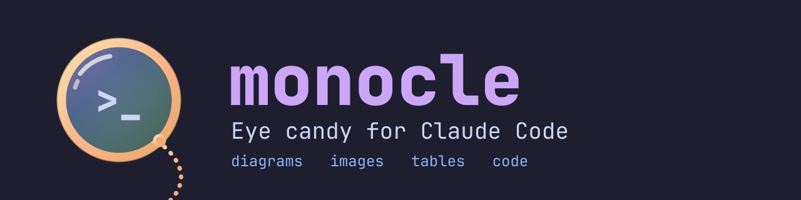
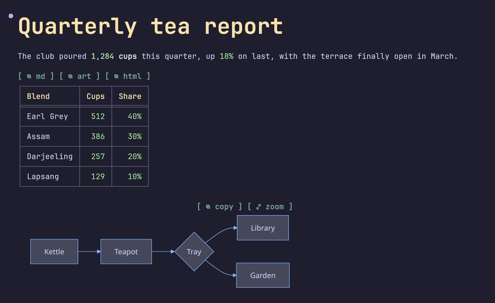
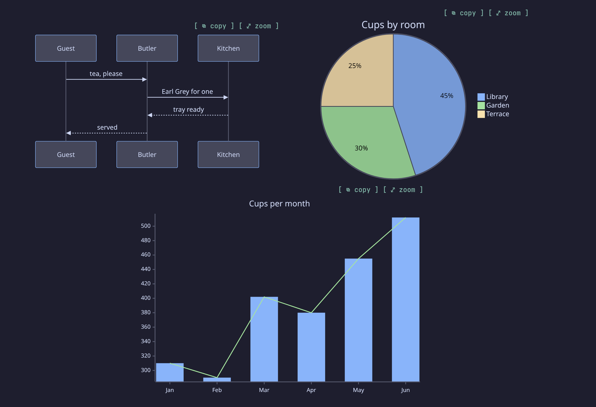
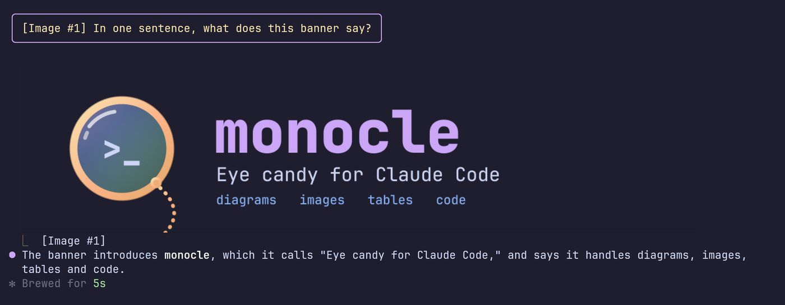

<h1 align="center"></h1>

<p align="center"><em>Eye candy for Claude Code: real diagrams, images and color in your terminal.</em></p>

<p align="center">
  <a href="https://github.com/DimitrisMilonopoulos/monocle/releases"></a>
  <a href="https://github.com/DimitrisMilonopoulos/monocle/actions/workflows/ci.yml"></a>
  <a href="LICENSE"></a>
  
</p>

<p align="center">
  <a href="#install"><strong>Install</strong></a> ·
  <a href="#themes">Themes</a> ·
  <a href="#features">Features</a> ·
  <a href="#configure">Configure</a> ·
  <a href="docs/CHANGELOG.md">Changelog</a>
</p>



## TL;DR

- Claude Code prints mermaid as source, tables as pipes and tool calls as walls of text. monocle draws them.
- In kitty and Ghostty you get real pixels: every mermaid diagram type as an image, big `#` and `##` headings in your terminal's font, the images you paste shown under your prompt, and LaTeX math. Click a diagram or image in kitty to see it full screen.
- Everywhere else, colored text art: flowcharts, sequence diagrams and charts, colored tables and code, and quiet tool rows.
- 15 palettes plus `mono`, and copy buttons on everything.
- Two commands to install, `/plugin` to turn it off. Claude Code's own renderer comes back the moment you do.
- No network calls. It runs local programs only for the features that need them: `mmdc` for diagram images, ImageMagick for big headings and pasted JPEGs, RaTeX's renderer for LaTeX, and the clipboard helper when you click `⧉ html`.

```
/plugin marketplace add DimitrisMilonopoulos/monocle
```

```
/plugin install monocle@monocle
```

Then run `/monocle demo` for a tour of the main features.

## Install

Requires Claude Code **2.1.287** or later. Run the two commands above.

To update, run this, then `/reload` in every open session. A session keeps the version it loaded until it reloads.

```bash
claude plugin marketplace update monocle && claude plugin update monocle@monocle
```

To uninstall:

```bash
claude plugin uninstall monocle@monocle
```

For LaTeX math, install RaTeX's renderer and set `latex` to `true`; see [LaTeX math](#latex-math). Until then formulas draw as text.

Diagrams as images, big headings, pasted-image previews and click to zoom need kitty or Ghostty and a few programs. [docs/SETUP.md](docs/SETUP.md) has the install commands for macOS and Linux, and `/monocle doctor` checks your machine and says what's missing.

## Features

| Feature | What you get |
| --- | --- |
| [Themes](#themes) | `/monocle theme <name>` switches on the spot. 16 themes and 20 color slots you can override |
| [Tables](#tables) | colored headers, rules, column alignment, colored numbers, sized to the terminal |
| [Code](#code) | a language header and copy button, Prism highlighting in two dozen languages, shell lines colored like a prompt |
| [Diagrams and charts](#diagrams-and-charts) | flowcharts, sequence, state, class and ER diagrams, bar and line charts, one color per box, participant and bar; with `mmdc`, real images of every mermaid type in kitty and Ghostty |
| [LaTeX math](#latex-math) | `$$` and ` ```math ` formulas typeset as images in kitty and Ghostty by [RaTeX](https://github.com/erweixin/RaTeX), text everywhere else |
| [Layout](#layout) | back-to-back tables and diagrams sit side by side and wrap on narrow terminals |
| [Copy buttons](#copy-buttons) | `⧉ md`, `⧉ art` and `⧉ html` on tables, `[ ⧉ copy ]` on code, lists and quotes, `/monocle copy` without a mouse |
| [Tool rows](#tool-rows) | `Ran gh pr view 12`, `Read ~/src/app.ts`, groups summed up as `Ran 3 commands, read 2 files`, with status dots; `toolOutput: quiet` hides what Claude only read and says in plain words what each call did |
| [Turn footer](#turn-footer) | `✻ Baked for 6m 20s` with the duration in the number color |
| [Slash commands](#slash-commands) | command output (`/cost`, `/context`, plugin commands) gets the same tables and code styling |
| [Diagram hints](#diagram-hints) | a short model-only note on each prompt so Claude reaches for diagrams and charts when they help |
| [Text](#text) | bold, italic, strikethrough, inline code, links, versions, durations, percentages and paths in their own colors |
| [Headings, lists, quotes](#headings-lists-quotes) | 4 heading styles, nested lists, task lists, quotes with an accent bar |
| [Your prompts](#your-prompts) | what you type draws in a bubble, an accent bar or a chevron, so you find your turns when you scroll back, and `clock` adds when you sent it and when the turn finished |
| [Right to left](#right-to-left) | Hebrew and Arabic read right to left, with bullets, quote bars and table columns mirrored |
| [Other mods](#other-mods) | `$.monocle.markdown` draws any markdown the way replies are drawn, for mod authors |

### Themes


Dark: `catppuccin-mocha` (default), `dracula`, `nord`, `tokyo-night`, `gruvbox-dark`, `rose-pine`, `everforest`, `github-dark`, `one-dark`, `solarized-dark`.

Light: `catppuccin-latte`, `gruvbox-light`, `rose-pine-dawn`, `github-light`, `solarized-light`.

`mono` drops the palette for bold and dim; alerts keep their colors. Switch with `/monocle theme nord`, or run `/monocle` for the help screen with every theme. Every palette is MIT licensed and credited in [THIRD_PARTY_NOTICES.md](docs/THIRD_PARTY_NOTICES.md).

### Tables

Header cells take the `tableHeader` color, and the default `box` style puts a double line under the header. `tableStyle` picks `box` (the default, every cell boxed), `rules`, `grid` or `minimal`. `:---:` and `---:` alignment is honored, numbers in cells get the number color, and columns shrink to fit the terminal.

### Code

Each code block gets a header row: the language on the left, a copy button on the right. The code sits indented below with no frame, so selecting it with the mouse copies only the code.

- **Prism** highlights JavaScript, TypeScript, JSX/TSX, Python, Go, Rust, Java, Kotlin, Swift, C, C++, C#, Ruby, JSON, YAML, TOML, SQL, HTML, CSS, Dockerfile, HCL and diff.
- **Shell** blocks (`bash`, `sh`, `zsh`, `fish`, `powershell`, unlabeled) color the command word, `--flags`, quoted strings and `# comments`, and restart after `|`, `&&` and `;`.

### Diagrams and charts

Code blocks tagged `mermaid` draw as colored text art:

- flowcharts (`graph LR`, `graph TD`, decisions), sequence, state, class and ER diagrams
- bar and line charts with `xychart-beta`, sized to the terminal width
- each box and participant gets its own theme color, the same at both ends of a sequence diagram
- bars in a multi-series chart get their own colors; a single-series chart prints each value above its bar and colors the tallest one
- gridlines stay dim, axis numbers use the number color

Diagrams too wide for the window, or over 80 lines, stay as code. `mermaidAscii` swaps box-drawing characters for `+ - |`.

#### Diagrams as images



In kitty and Ghostty (not under tmux), monocle renders each mermaid block with [mermaid-cli](https://github.com/mermaid-js/mermaid-cli) and draws it as a real image in the theme's colors. Every mermaid type works this way, including the ones text art can't draw: pie, gantt, mindmap, timeline, quadrant and git graphs. It needs `mmdc` on your `PATH` and a Chrome or Chromium it can start; when puppeteer has no browser of its own, monocle points it at `/usr/bin/chromium` or another system browser it finds.

- A diagram draws as text art first and turns into an image once `mmdc` is done, about two seconds for the first one. All diagrams in a reply render in one run, and results are kept for the session.
- An image is sized to match the terminal text and never stretched. A diagram that would have to shrink below half its size to fit stays text art or source.
- A diagram `mmdc` rejects stays text art or source; the others still render.
- In kitty, click a diagram or press `⤢ zoom` beside its copy button to see it full screen: monocle renders it again at twice the resolution and opens it in a kitty overlay over the session, using kitty's remote control. Enter closes it. Not under tmux or SSH.
- While it works, the [diagram hints](#diagram-hints) note also tells Claude that every mermaid type renders.

`mermaidImages` turns it off. Without `mmdc`, nothing changes from the text art.

### LaTeX math

Display math, `$$…$$` on lines of its own or a ` ```math ` block, draws as a typeset image in the theme's diagram text color, one formula per line. With copy buttons on, its `⧉ copy` button copies the formula's LaTeX, since selecting an image copies blank cells. It needs [RaTeX](https://github.com/erweixin/RaTeX)'s PNG renderer, a single binary that typesets KaTeX syntax in a few milliseconds without TeX, a browser or Node:

```bash
gh release download -R erweixin/RaTeX -p 'ratex-cli-*-aarch64-apple-darwin.tar.gz'
tar -xzf ratex-cli-*.tar.gz
mkdir -p ~/.local/bin
install ratex-cli-*/render ~/.local/bin/ratex-render
```

Pick the archive for your platform (`x86_64-apple-darwin`, `x86_64-unknown-linux-musl`, ...). Any directory on your `PATH` works, but the file must be named `ratex-render`.

LaTeX is off until you set `latex` to `true`. Then monocle runs `ratex-render` once in kitty and Ghostty, outside tmux, and keeps LaTeX on only if that test formula comes back. If a later run fails, formulas already drawn stay and new ones stay text until you `/reload`. A reply shown before the test finishes draws its formulas as text, then redraws them as images. Anywhere else, without the renderer, or with `latex` off, formulas draw as text in a `math` code block. So does a formula the renderer rejects, or one too wide for the terminal even at one row. While LaTeX is on, the [diagram hints](#diagram-hints) note also tells Claude that `$$` math renders. Inline `$…$` draws as italic text without its dollar signs, with common commands such as `\rho`, `\cdot` and `\le` shown as symbols; amounts like `$5` stay as written.

Formula text matches the reply text. A terminal image fills whole rows, so a formula that falls between two row counts is rendered again with more padding rather than stretched.

### Layout

When tables and diagrams follow each other, they share a row and wrap once the terminal runs out of width. A wide terminal shows a table, a flowchart and two charts side by side.

### Copy buttons

- **Tables:** `⧉ md` copies the original Markdown and `⧉ art` a boxed table that pastes well into Slack. `⧉ html` copies a formatted table (headers, alignment, inline formatting) plus a tab-separated plain-text copy.
- **Code, lists and quotes:** `[ ⧉ copy ]` on each. Code copies without its fences, lists as markdown, quotes without their `> ` markers.
- **Diagrams:** `⧉ source` copies the mermaid code, `⧉ art` the drawn art.
- **Whole replies:** replies with more than one block, or any Hebrew or Arabic, end with `⧉ copy reply`, which copies the reply as Claude wrote it. Selecting right-to-left text on screen copies letters in drawn order, not reading order.
- **No mouse:** `/monocle copy` copies the last reply, `/monocle copy code` its last code block.

`⧉ html` shows in a local macOS terminal or a Linux graphical session. macOS needs nothing extra. Linux needs [CopyQ](https://copyq.readthedocs.io/en/stable/installation.html) running (see its [Wayland caveats](https://copyq.readthedocs.io/en/stable/known-issues.html#on-linux-some-features-do-not-work-under-wayland)). On Ubuntu:

```bash
sudo apt install -y copyq && copyq --start-server && copyq config autostart true
```

Clicking works where the terminal passes clicks through, as fullscreen mode does. Terminals with copy-on-select, such as Warp, may grab the word "copy" instead.

### Tool rows

Each tool call draws as one line: a verb and its target, `Ran` with a colored shell command, `Read` and `Edited` with the path. A status dot shows done, running or failed, and output still draws below.

Collapsed groups draw one line too: `Ran 3 commands, read 2 files · last: npm test`, with `· N failed` in the flag color when any call failed. Expand a group (ctrl+o or `--verbose`): shell calls keep their colored command with the output boxed below, and other calls use Claude Code's own rows. ctrl+o on a reply shows the original text.

`toolStyle` keeps tool rows apart from what Claude says:

| `chat` (default) | `tree-dim` | `tree-bold` | `classic` |
|---|---|---|---|
| dimmed on the right, capped at 60% of the width | tucked under the sentence with `⎿`, dimmed | `tree-dim` with one-line sentences in bold | bold verb and status dot, full brightness |

`toolOutput: quiet` shows what Claude did, not what it read: reads, searches and read-only shell commands draw one plain row like `Read src/report.py lines 1–10` and nothing under it. Edits keep their diff and failures show their real error; the full rules are in [docs/tool-output.md](docs/tool-output.md).

### Turn footer

The line that closes a turn keeps Claude Code's word and colors the duration: `✻ Baked for 6m 20s`. Terminal only, since that's the only surface that draws it.

### Slash commands

Output from slash commands, built-in or from other plugins, is drawn like a reply, copy buttons included. Errors keep Claude Code's own red line.

### Diagram hints

Claude rarely writes a chart unless it knows the terminal can draw one. With `diagramHints` on (the default), each prompt you type carries a short note that only the model reads. It says tables, alerts, code, mermaid diagrams and `xychart-beta` charts render here, and asks for commands in fenced blocks, since only those get a copy button.

The note costs about 190 tokens per prompt, and about 60 more while [LaTeX math](#latex-math) is on, when it also says `$$` formulas render. It's off whenever `mermaid` is off, and skipped for headless `claude -p` runs and background notifications.

### Text

**Bold**, *italic*, ~~strikethrough~~, `inline code`, links and bare URLs, clickable as terminal hyperlinks. Numbers, versions (`v2.14.0`), durations (`250ms`, `3h`), sizes (`16Gi`) and percentages (`99.9%`) take the number color, and paths like `~/src/app.ts` the path color.

### Headings, lists, quotes

`headingStyle` picks `banner` (the default: a box around H1, a heavy rule under H2), `bold`, `underline` or `uppercase`. Each level has its own color from the theme: H1 the heading color, H2 the accent, H3 the link color, H4 the number color, H5 and H6 the emphasis color.

In kitty and Ghostty (not under tmux), `#` and `##` headings draw larger, three and two rows tall, as images that ImageMagick (`magick` on your `PATH`) renders in your terminal's bold font: in kitty, the `font_family` from your kitty.conf. They show as normal text until the image is ready, a few tens of milliseconds. A heading still being written stays text until the reply moves past it, and long headings wrap. A big heading can't be selected as text; `⧉ copy reply` still has it. `headingImages` turns it off.

Lists keep their numbers and nest with `•` and `◦`. Quotes get an accent bar, and GitHub alerts (`> [!NOTE]`, `[!TIP]`, `[!IMPORTANT]`, `[!WARNING]`, `[!CAUTION]`) draw as colored boxes.

Task lists draw as `[ ]` and `[✓]`, with done items dimmed and struck through. `taskStyle` switches to `ticks` (`○` `✓`), `box` (`□` `✓`) or `progress`, which adds a done-count bar above each list.


### Your prompts

What you type, at the prompt or through Remote Control, draws in the theme's colors. `promptStyle` picks the look, and `off` keeps Claude Code's own. Task notifications and teammate messages are left alone.

| `bubble` (default) | `bar` | `chevron` |
|---|---|---|
|  |  |  |



Images you paste show under the prompt that carried them, in kitty and Ghostty (not under tmux), instead of only `[Image #1]`: up to 12 rows tall, keeping their shape. In kitty, click one to see it full screen in the same overlay diagrams use. A pasted JPEG, GIF or WebP is converted to PNG with ImageMagick first; without it, only PNGs show.

`clock` adds the time: each prompt shows when you sent it, and the line that closes each turn when it finished (`✻ Baked for 1m 55s · 14:32`). It reads `24h` or `12h`, and a time from another day gets its date. With `promptStyle: off` the time goes in front of Claude Code's own prompt row. Off by default.

| `clock: 24h` on a prompt | and on a turn's last line |
|---|---|
|  |  |

### Right to left

Hebrew and Arabic blocks are right aligned, with bullets, numbers and quote bars on the right and table columns mirrored. Code, numbers, paths and links stay left to right inside them. Terminals treat right-to-left letters differently, so monocle detects yours and sends the letters the way it needs them. `/monocle demo-rtl` shows every element, and the `rtl` option forces a terminal's handling or turns it off.

## Configure

Open `/config` and look for the **monocle** rows, or set values in `~/.claude/settings.json`:

```json
{
  "pluginConfigs": {
    "monocle@monocle": {
      "options": {
        "theme": "tokyo-night",
        "tableStyle": "grid",
        "headingStyle": "banner",
        "tableHeaderColor": "#ffcc00",
        "numberColor": "cyan"
      }
    }
  }
}
```

Options sit under `options`, keyed by the plugin's install name. Project settings are not read for plugin options.

| Option | Values | Default |
| --- | --- | --- |
| `enabled` | `true`, `false` | `true` |
| `theme` | see [Themes](#themes), or `random` for a new dark color preset each time the mod loads | `catppuccin-mocha` |
| `tableStyle` | `box`, `rules`, `grid`, `minimal` | `box` |
| `taskStyle` | `checks` (`[ ]` `[✓]`, done struck through), `ticks` (`○` `✓`), `box` (`□` `✓`), `progress` (ticks with a done-count bar) | `checks` |
| `promptStyle` | `bubble`, `bar`, `chevron`, `off` | `bubble` |
| `clock` | `off`, `24h`, `12h` | `off` |
| `headingStyle` | `banner`, `bold`, `underline`, `uppercase` | `banner` |
| `highlightNumbers` | `true`, `false` | `true` |
| `highlightPaths` | `true`, `false` | `true` |
| `toolRows` | `true`, `false` | `true` |
| `toolStyle` | `chat`, `tree-dim`, `tree-bold`, `classic` | `chat` |
| `toolOutput` | `full`, `quiet` | `full` |
| `copyButtons` | `true`, `false` | `true` |
| `diagramHints` | `true`, `false` | `true` |
| `rtl` | `auto`, a terminal (`warp`, `kitty`, `apple-terminal`, `iterm`, `ghostty`, `wezterm`, `vscode`, `alacritty`, `windows-terminal`, `gnome`, `konsole`), `off` | `auto` |
| `mermaid` | `true`, `false` | `true` |
| `mermaidAscii` | `true`, `false` | `false` |
| `mermaidImages` | `true`, `false` | `true` |
| `headingImages` | `true`, `false` | `true` |
| `latex` | `true`, `false` | `false` |
| `<token>Color` | any color, see below | theme |

A color is hex (`#a6e3a1`, `#fc0`), `rgb(166,227,161)`, `ansi256(114)` or a name (`green`, `cyanBright`). Values that don't parse are ignored. Every token has a `<token>Color` option and a row in `/config`:

| Token | Colors |
| --- | --- |
| `accent` | reply bullet, H3+ headings, quote bar, running tool dots |
| `heading` | H1 and H2 |
| `strong` | **bold** text |
| `emphasis` | *italic* text, variables, attribute names |
| `inlineCode` | `inline code` |
| `codeText` | code block text |
| `codeCommand` | shell commands, functions, class names, keys |
| `codeFlag` | `--flags`, keywords, failures |
| `codeString` | strings |
| `codeComment` | comments, the code block's language label |
| `link` | links, URLs, properties, tags |
| `path` | file paths, regexes |
| `number` | numbers, versions, durations, done dots |
| `quote` | quote text |
| `rule` | rules, chart gridlines |
| `tableHeader` | table header cells |
| `tableRule` | table rules |
| `bullet` | list bullets and numbers |
| `diagram` | diagram lines |
| `diagramText` | diagram labels and LaTeX formulas |

## Troubleshooting

- **A setting or update didn't take:** run `/reload`. A session keeps what it loaded.
- **A diagram shows as code:** its source is over 80 lines or 8,000 characters, it's wider than the window, it doesn't parse, or `mermaid` is off. Widen the terminal or split the diagram.
- **No `⧉ html` on tables:** you're over SSH, in the desktop app or VS Code, or on Linux with no graphical session. `⧉ md` and `⧉ art` still work.
- **`⧉ html` copied plain text only:** CopyQ isn't running, or the clipboard helper failed. The toast says why.
- **Clicking a copy button selects the word "copy":** your terminal copies on select. Use `/monocle copy`.

## Limits

- The parser covers what Claude writes (headings, lists, tables, fences, quotes, emphasis, links). It's not full CommonMark: nested quotes and HTML draw as plain text.
- Widths count CJK and emoji as two columns. Terminals disagree on a few emoji, so those can still be off by one.
- Languages outside the 24 above draw in `codeText`.
- Tested by hand in kitty on Linux; CI runs the tests on macOS, Linux and Windows. Ghostty, the desktop app, VS Code and mobile use the same mod API but are not checked by hand yet.

<details>
<summary>For LLMs and agents</summary>

To change the code, read [AGENTS.md](AGENTS.md) instead.

- **What it is:** a Claude Code mod (function hooks in TypeScript) that redraws assistant replies, slash-command output, tool rows, the turn footer and user prompts. It changes how things look. The one thing it sends the model is the optional diagram hint below.
- **Install:** `/plugin marketplace add DimitrisMilonopoulos/monocle`, then `/plugin install monocle@monocle`. Needs Claude Code 2.1.287+. Changes apply after `/reload`.
- **Configure:** `/monocle theme <name>` is the only setter at runtime. Every other option is a key under `pluginConfigs["monocle@monocle"].options` in `~/.claude/settings.json` (or a row in `/config`), then `/reload`. Options and defaults are in the [Configure](#configure) table; the machine-readable source is `userConfig` in [.claude-plugin/plugin.json](.claude-plugin/plugin.json). Color values that don't parse are ignored.
- **Side effects:** no network. Programs it runs: the `⧉ html` clipboard helper (`/usr/bin/osascript` on macOS, `copyq` on Linux, 5 second timeout, only on a click), `ratex-render` while `latex` is on, `mmdc` (which starts a headless Chrome) for mermaid blocks while `mermaidImages` is on, in kitty or Ghostty, `kitty @ launch` when you zoom a diagram, and `magick`, `fc-match` and `kitty +runpy` (to find your font) for big headings while `headingImages` is on. With `diagramHints` on, it adds about 190 tokens of model-only context to each typed prompt.
- **Turning it off:** `"enabled": false`, or disable the plugin in `/plugin`.
- **For other mods:** `$.monocle.markdown({ surface, text, columns })`, typed in [types/index.d.ts](types/index.d.ts). See [Other mods](#other-mods).

</details>

## Develop

```bash
git clone https://github.com/DimitrisMilonopoulos/monocle
claude --plugin-dir ./monocle
```

Edits hot-reload in that session. Before a PR run `claude plugin validate .` and `claude plugin test .`, and print [docs/demo.md](docs/demo.md) to check the look. `npm --prefix scripts run bench` times a full render of the demo reply, so speed claims can be checked on any machine. The full rules and verify loop are in [AGENTS.md](AGENTS.md).

### Other mods

Other mods can draw markdown in the user's theme with `$.monocle.markdown`. Pass the surface, the text and the content width in columns.

- It answers the tree to draw, or `undefined` when monocle is disabled or the text holds nothing to draw.
- It throws when monocle isn't installed, so call it in a `try`.
- Monocle draws at least 20 columns wide. Copy buttons are left out, because a button can't cross from one mod to another.

```tsx
let drawn
try {
  drawn = await $.monocle.markdown({ surface: e.surface, text, columns: e.props.bodyColumns })
} catch {}
return drawn ?? <Markdown text={text} />
```

The types are in [types/index.d.ts](types/index.d.ts). List monocle under `dependencies` in your `plugin.json` and Claude Code lays them into your `.claude-plugin/types/`. When monocle is optional, declare the noun in your own contract instead:

```ts
declare module 'claude-code' {
  interface EngineInterface {
    monocle: {
      markdown: (args: { surface: RenderSurface; text: string; columns: number }) => Promise<RenderElement | undefined>
    }
  }
}
```

## Credits

monocle is made by [Dimitrios Milonopoulos](https://github.com/DimitrisMilonopoulos). It started as a fork of [prismantis](https://github.com/NahumLitvin/prismantis) by [Nahum Litvin](https://github.com/NahumLitvin), whose work covers everything up to 0.17.1 in the [changelog](docs/CHANGELOG.md).

## License

[MIT](LICENSE). Bundled third-party code is listed in [THIRD_PARTY_NOTICES.md](docs/THIRD_PARTY_NOTICES.md).
