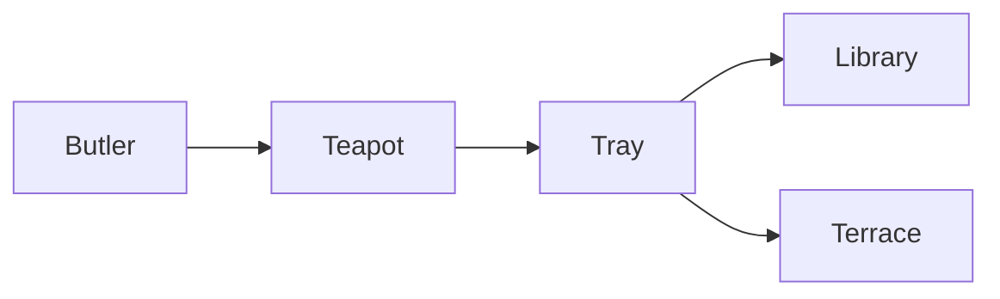
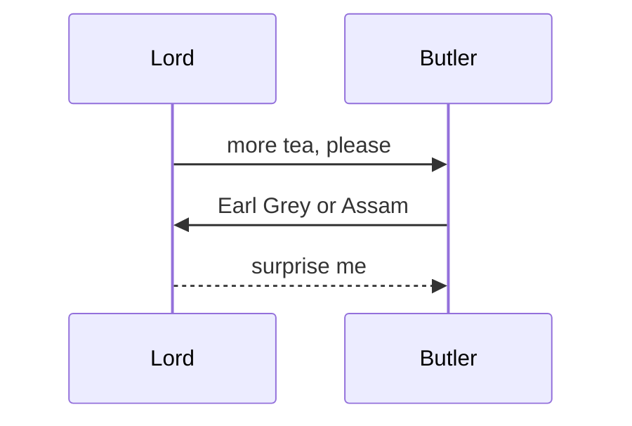
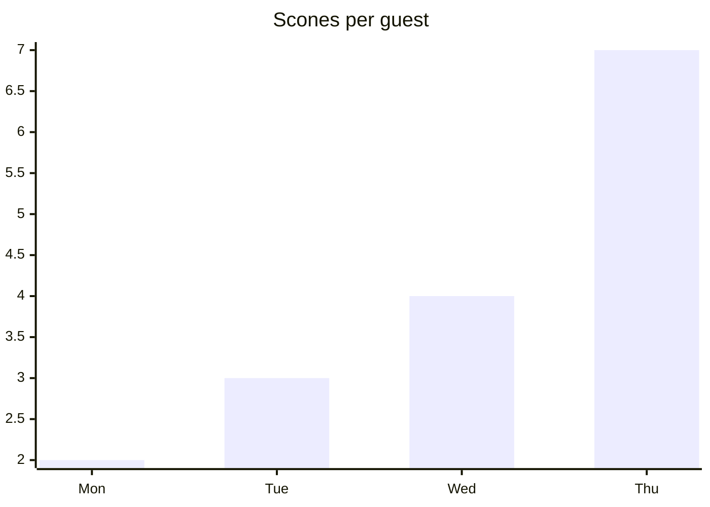

# monocle

**Afternoon tea report:** Lord Pemberton poured 3 pots in 6m 20s, scone stock up 18% to 82 per hour. Notes in ~/club/ledger.md, minutes at https://github.com/DimitrisMilonopoulos/monocle

## Roster

| Member | Club | Accessory | Lens |
| :--- | :--- | :--- | ---: |
| Lord Pemberton | Drones | gold monocle | 32mm |
| Lady Ashcombe | Diogenes | opera lorgnette | 28mm |
| Sir Reginald | Reform | pocket loupe | 21mm |

1. Polish the monocle
2. Ring for tea
   - Earl Grey
   - no milk







```mermaid
xychart-beta
  title "Monocles dropped"
  x-axis [Jan, Feb, Mar, Apr]
  line [2, 4, 6, 9]
```

```ts
const butler = "Jeeves" // discreet, punctual
export function serve(guest: string, cups = 3) {
  return `${guest} took ${cups} cups`
}
```

```bash
tea brew --blend "Earl Grey" --cups 3 --steep 4m && echo "splendid"
```

> [!TIP]
> If `the kettle` returns 404, try `the samovar` first.

> A gentleman never squints.

## עברית

**שלום חברים**, התוסף מצייר גם עברית עם מונחים באנגלית כמו `kubectl`, מספרים כמו 99.9% ו-250ms, וגם [קישור](https://github.com/DimitrisMilonopoulos/monocle).

- פרוסים ב-us-east ו-eu-west (שני אזורים)
- מחליפים ערכת נושא עם `/monocle theme nord`

1. מצחצחים את המונוקל
2. מזמינים תה

> עברית נקראת מימין לשמאל, גם בטרמינל בלי תמיכה בכיווניות

| אורח | מועדון | אביזר |
| :--- | :--- | :--- |
| הלורד | דרונס | מונוקל זהב |
| הליידי | דיוגנס | משקפי אופרה |

```bash
ls -la # רשימת הקבצים
```
